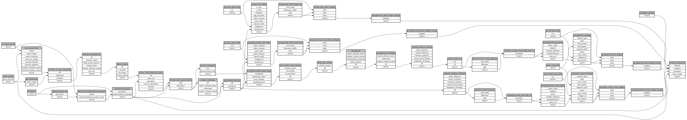

```
# AUTOGENERATED BY ECOSCOPE-WORKFLOWS; see fingerprint in README.md for details

```

```yaml
# fingerprint:
artifacts_sha256_basic: 0d2a8b9327a0db3bc04570bbcd8669a7b930da2dd7bab4f911427a2381223744
artifacts_sha256_strict: b318ce8599c52ddf53f2202ef8d74b393f76ada15e126469dbc2cb25d0f71753
installed_requirements:
- channel: https://repo.prefix.dev/ecoscope-workflows/
  name: ecoscope-platform
  version: {version: ==2.31.0}
- channel: conda-forge
  name: pydeck
  version: {version: ==0.9.2}
params_sha256: 1873f5465b4fc3038e9724854a8a4657b92b015b66328a1956ea2a181efaf3c2
spec_sha256: a2d70a584e5338d0f2b5088b3dcf47f23f6cb3e5a325be81b50e9321617ecd08

```

# ecoscope-workflows-events-workflow



